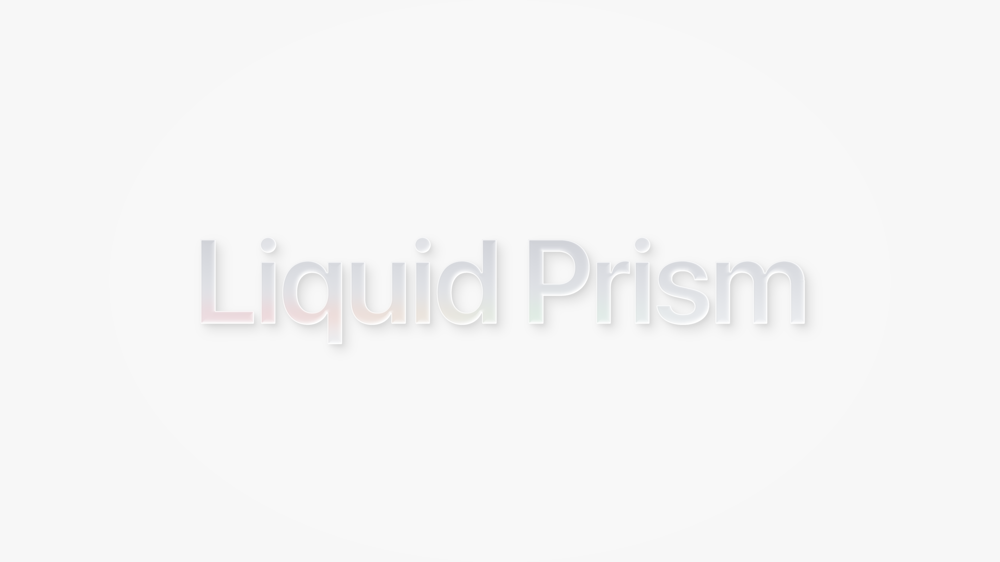

# Liquid Prism

Liquid glass surfaces, spring-driven controls, adaptive iOS chrome, and native UIKit popup menus for Flutter.

## Install

Requires **Flutter 3.50+ / Dart 3.14+**. Supported app targets are iOS and Android. Native popup menus require iOS 17.4+ (other platforms use a Material fallback). Glass uses Impeller shader filters when supported and a frosted fallback otherwise.

```yaml
dependencies:
  liquid_prism:
    git:
      url: https://github.com/rehmatsg/liquid_prism.git
      ref: v1.0.0 # x-release-please-version
```

Upgrading from `0.x`? See the [1.0 migration guide](doc/migration-1.0.md).

## Quick start

```dart
import 'package:liquid_prism/liquid_prism.dart';
import 'package:material_ui/material_ui.dart';

Future<void> main() async {
  WidgetsFlutterBinding.ensureInitialized();
  await Prism.initialize();
  runApp(const MaterialApp(home: GlassPage()));
}

class GlassPage extends StatelessWidget {
  const GlassPage({super.key});

  @override
  Widget build(BuildContext context) => Scaffold(
    body: Stack(
      fit: StackFit.expand,
      children: [
        const DecoratedBox(
          decoration: BoxDecoration(
            gradient: LinearGradient(
              colors: [Color(0xFF146B8F), Color(0xFFB686C8)],
            ),
          ),
        ),
        Center(
          child: PrismSurface(
            glass: PrismGlass.clear,
            shape: const PrismShape.rect(cornerRadius: 28),
            child: const Padding(
              padding: EdgeInsets.all(24),
              child: Text('Hello, glass'),
            ),
          ),
        ),
      ],
    ),
  );
}
```

Use `PrismGlass.regular`, `PrismGlass.clear`, and `PrismGlass.identity` for material selection, `.tint(color)` to tint, and `.interactive()` for press feedback.

## Components

| Need | Widget |
| --- | --- |
| Glass surface | `PrismSurface`, `PrismGroup` |
| Button or circular icon | `PrismButton`, `PrismButton.icon`, `PrismButton.menu` |
| Toggle switch | `PrismSwitch` |
| Continuous or stepped slider | `PrismSlider` |
| Segmented control | `PrismSegmentedControl<T>` |
| Floating navigation tabs | `PrismTabBar`, `PrismTab` |
| Adaptive app layout & pull-to-refresh | `PrismScaffold`, `PrismSliverAppBar`, `PrismRefreshController` |
| Grouped glass actions | `PrismToolbar`, `PrismToolbar.group`, `PrismBackButton` |
| Search bar | `PrismSearchField` |
| Scroll edge blur & fade | `PrismScrollEdge`, `PrismScrollEdge.fade` |
| Enter/exit materialize transition | `PrismVisibility`, `PrismVisibility.driven` |
| Native iOS popup menu | `PrismMenu`, `PrismMenuRegion`, `prismMenus` |

Low-level building blocks (`PrismOptics`, `PrismLensStyle`, `PrismPressable`, `PrismSelection`, `PrismEdgeBlur`, `PrismEdgeFade`, `PrismPresence`, `PrismSystemChrome`, `PrismTabReselection`) are exported from `package:liquid_prism/primitives.dart`.

## Styling & theming

Widgets accept semantic and behavioral inputs directly; visual, geometry, motion, optical, and haptic overrides live in immutable `Prism*Style` objects and inherit from `PrismTheme`:

```dart
PrismTheme(
  data: const PrismThemeData(
    tint: Color(0xFF6155F5),
    button: PrismButtonStyle(minimumSize: Size(88, 48)),
    slider: PrismSliderStyle(trackHeight: 8),
    lens: PrismLensStyle(shadowOpacity: .08),
    toolbar: PrismToolbarStyle(spacing: 10),
  ),
  child: myApp,
)
```

Use `PrismColors.of(context)` for the adaptive light/dark semantic palette. Resolution order is always: local widget `style` > `PrismThemeData` > native default.

## Documentation

- [Component guide](doc/components.md)
- [Theming & styles](doc/customization.md)
- [Motion & lenses](doc/motion_and_lenses.md)
- [Native iOS menus](doc/native_menus.md)
- [Rendering & performance](doc/rendering.md)
- [1.0 migration guide](doc/migration-1.0.md)

## Showcase

```sh
cd example
flutter pub get
../tool/run_example.sh <device-id>
```

For contributors, see [CONTRIBUTING.md](CONTRIBUTING.md).

## License & credits

BSD-3-Clause, with the merged Liquid Menu bridge under MIT. Built with research from [Liquid Glass Easy](https://github.com/AhmeedGamil/liquid_glass_easy) and [GPUI Glass Demo](https://github.com/luciascarlet/gpui-glass-demo). See [LICENSE](LICENSE), [LICENSE-liquid-menu](LICENSE-liquid-menu), and [THIRD_PARTY_NOTICES.md](THIRD_PARTY_NOTICES.md).
